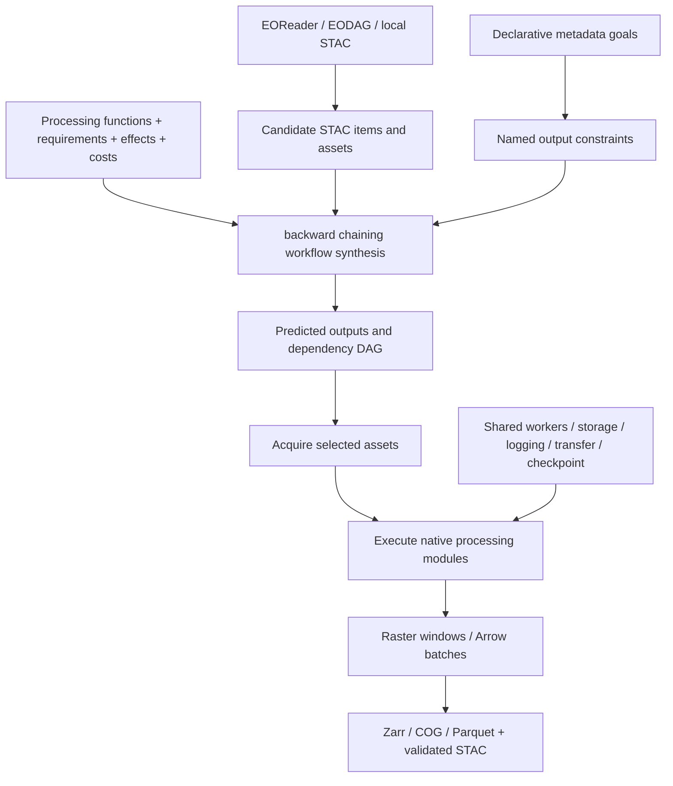

# AutostacGIS specification 0.0.1

AutoSTACGIS turns available geospatial data and requested output metadata into a processing workflow. Candidate data is described by STAC Items and assets. Python modules declare input requirements, output effects, and costs. Declarative metadata goals describe the required results.

This repository contains the specification, JSON Schemas, pinned STAC extension schemas, and JSON/YAML examples. [autostacgis-python](https://github.com/autostacgis/autostacgis-python) contains the implementation and pinned EODAG and EOReader forks. A server is not required.

Initial and generated datasets use the same data-object model. Modules create named output objects; later modules can consume them. Sequence plugins select actual members for collection operations. The planner can choose a subset of available data or require a corresponding processed output for every selected input.

- [Specification](specification.md)
- [Plugin schema](schemas/plugin.json), [goal schema](schemas/goal.json), [combined config schema](schemas/config.json), [catalog schema](schemas/catalog.json), [request schema](schemas/request.json)
- [STAC extensions](extensions/README.md), [Data State extension](https://github.com/autostacgis/stac-data-state)
- [Configuration references](examples/README.md), [complete configuration](examples/configuration-reference/config.yaml). Practical workflows live in [autostacgis-python](https://github.com/autostacgis/autostacgis-python/tree/main/examples).

The standard run configuration is one self-contained YAML or JSON file with plugin types as top-level sections. `solver` selects one solver and `goal` describes the desired data. Processing output saving is configured independently under `process.<plugin>.outputs.<port>`, and is off by default. Most settings can be omitted to retain their defaults. JSON is the configuration model; YAML is an optional authoring syntax. Processing declarations live alongside their implementation functions. STAC describes datasets; AutoSTACGIS defines goals, transformations, and execution contracts. This remains prerelease version `0.0.1`.

Validate with `python tools/validate.py` after installing `jsonschema`, `referencing`, and `PyYAML`.

YAML catalogs select installed plugins by registration name, for example `plugins: [{use: markov_seamlines}, {use: mosaic}]`. Dependencies load automatically through the `autostacgis.plugins` entry-point group. Each plugin explicitly declares one capability. Implementations live in [autostacgis-plugins](https://github.com/autostacgis/autostacgis-plugins/tree/main/plugins/autostacgis_plugins). Competing producers of a required state are a configuration error. The backward solver reports a feasible synthesized graph without claiming global cost optimality. See the [configuration reference](examples/configuration-reference/config.yaml) for the complete configuration layout.

## Applications and services

- [autostacgis-postgresql](https://github.com/autostacgis/autostacgis-postgresql): independent PostgreSQL/PostGIS/pgSTAC catalog, standard STAC API, COG tile preview and AutoSTACGIS planning/jobs.
- [autostacgis-qgis-plugin](https://github.com/autostacgis/autostacgis-qgis-plugin): STAC search, assets and workflow results in QGIS's main map, with per-capability plugin settings.
- [autostacgis-web](https://github.com/autostacgis/autostacgis-web): Kepler.gl workspace and Electron desktop builds for macOS, Windows and Linux, with an optional bundled backend that starts on explicit request.

Both clients use the same standard STAC endpoints and optional `/autostacgis` configuration, planning and job API. The Python library supplies managed APScheduler and watchdog triggers, registered independently by the standard plugin distribution.

The optional `metadata_structure` configuration section combines STAC Item JSON Schema URLs (`schemas`) with an inline Item JSON Schema (`inline`). With `strict: true` (the default when this section is present), undeclared metadata is an error. STAC's core Item schema is always included. Declare extension schemas explicitly. See the Python library's metadata structure documentation for plugin access and nested field rules.
