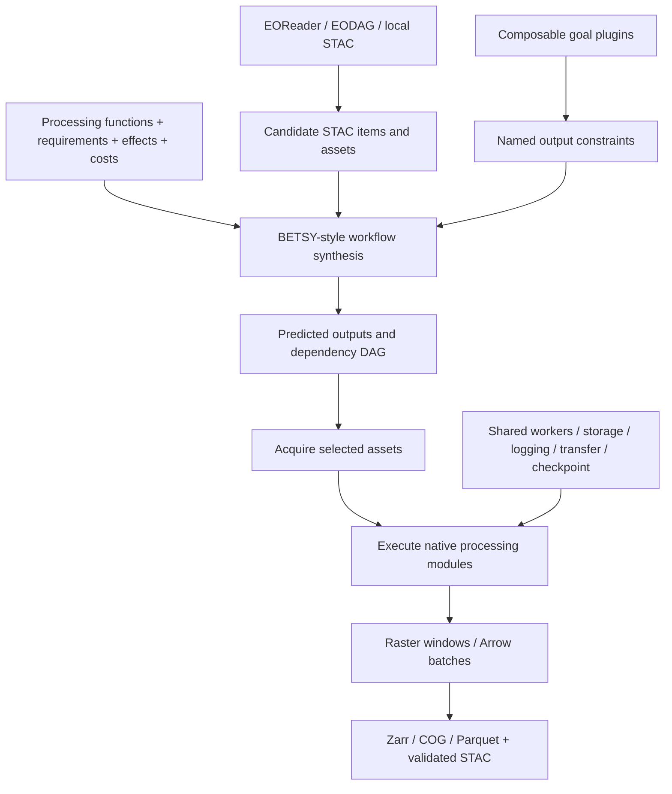

# AutoSTACGIS specification 1.0

AutoSTACGIS turns available geospatial data and requested output metadata into a processing workflow. Candidate data is described by STAC Items and assets. Python modules declare input requirements, output effects, and costs. Composable goal plugins describe the required results.

This repository contains the specification, JSON Schemas, pinned STAC extension schemas, and JSON/YAML examples. [autostacgis-python](https://github.com/autostacgis/autostacgis-python) contains the implementation and pinned EODAG and EOReader forks. A server is not required.

Initial and generated datasets use the same data-object model. Modules create named output objects; later modules can consume them. Sequence plugins select actual members for collection operations. The planner can choose a subset of available data or require a corresponding processed output for every selected input.

- [Specification](specification.md)
- [Plugin schema](schemas/plugin.json), [goal schema](schemas/goal.json), [combined config schema](schemas/config.json), [catalog schema](schemas/catalog.json), [request schema](schemas/request.json)
- [STAC extensions](extensions/README.md), [Data State extension](https://github.com/autostacgis/stac-data-state)
- [Configuration references](examples/README.md), [complete configuration](examples/configuration-reference/config.yaml). Practical workflows live in [autostacgis-python](https://github.com/autostacgis/autostacgis-python/tree/main/examples).

The standard run configuration is one self-contained YAML or JSON file with `catalog` (available plugins) and `request` (goals and overrides) sections. Most settings can be omitted to retain their defaults. JSON is the configuration model; YAML is an optional authoring syntax. Processing declarations live alongside their implementation functions. STAC describes datasets; AutoSTACGIS defines goals, transformations, and execution contracts. This remains specification version `1.0.0`.

Validate with `python tools/validate.py` after installing `jsonschema`, `referencing`, and `PyYAML`.

YAML catalogs select installed plugins by registration name, for example `plugins: [{use: markov_seamlines}, {use: mosaic}]`. Dependencies load automatically from the Python `autostacgis.plugins` namespace. Competing producers of a required state are a configuration error. The backward solver reports a feasible synthesized graph without claiming global cost optimality. See the [configuration reference](examples/configuration-reference/config.yaml) for the complete configuration layout.
